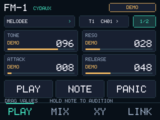
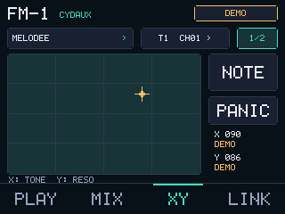
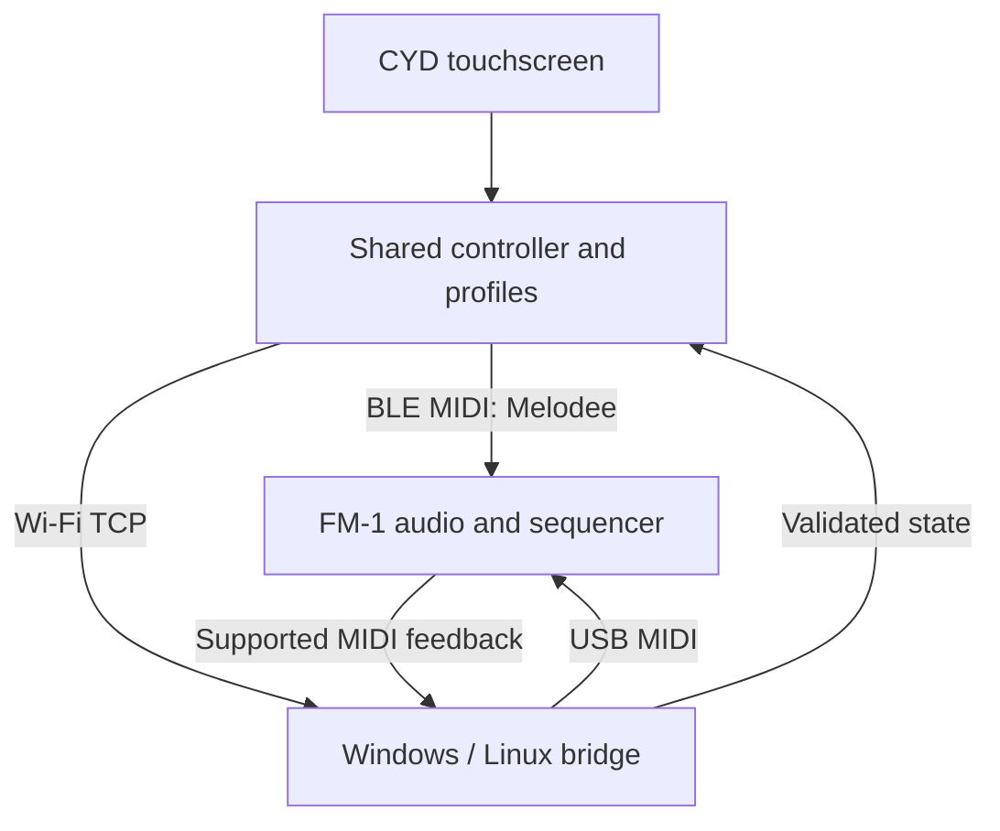

# FM-1 CYDaux

**A touchscreen performance companion for the M-VAVE FM-1, running on the
original ESP32-2432S028R Cheap Yellow Display.**

Choose an FM-1 firmware profile, control it from the CYD, and keep the FM-1
making the sound. The project includes the CYD firmware, a Windows/Linux USB
MIDI bridge, and a desktop simulator that runs the same C++ controller and UI.

**Status:** first implementation; compiled and software-tested, with physical
CYD/FM-1 qualification still pending. Development began before the FM-1 arrived.
The simulator and mock bridge make the controls and protocol behavior usable
now. Successful builds publish downloadable artifacts in
[Actions → Build and qualify](https://github.com/techrote/FM-1-CYDaux/actions/workflows/build.yml).

| Play | XY control |
| --- | --- |
|  |  |

These are actual 320×240 frames from the shared renderer, not hardware photos.

## The firmware shortlist

| Profile | Why it is included | Connection | Implemented scope |
| --- | --- | --- | --- |
| **[Melodee](https://github.com/keremimo/melodee)** | First choice for a direct wireless companion | **BLE MIDI**, or Wi-Fi/USB bridge | Four tracks, eight performance controls, level/pan, notes, XY |
| **[SLOOP](https://github.com/isod89/sloop-fm1)** | First choice for integrated groovebox transport and live feedback | Wi-Fi/USB bridge | Three synth tracks + drums, controls, program changes, negotiated LIVE Play/Stop |
| **[Skiff](https://github.com/illuminus5/skiff)** | Six-track alternative with useful performance MIDI | Wi-Fi/USB bridge | Six tracks, controls, mix, program changes and notes |
| **[X0X](https://github.com/charlesvestal/fm1-x0x)** | A distinct acid-oriented control surface | Wi-Fi/USB bridge | The two 303 parts, native CC16–23, level, notes, Start/Stop |

The recommendation is to try **Melodee first for BLE**, then **SLOOP for the
richer bridge integration**. Skiff and X0X provide two different musical
directions without pretending their protocols are identical. Each profile is
audited against a pinned upstream source revision; see
[firmware mappings, routing and limitations](docs/firmwares.md) and the
[machine-readable source manifest](docs/upstream-sources.json).

Stock FM-1 firmware and other forks are outside the current profile set. A
similar device or MIDI port name does not establish compatibility with these
control maps.

The CYD profile selector chooses a control map. It does not install or change
the FM-1 firmware. Install a chosen firmware using its own upstream instructions
when the FM-1 arrives, and match its MIDI routing to the selected profile.

## How the connection works



The classic ESP32-2432S028R's USB connection is serial, not a native USB host
for the FM-1. The bridge lets an ordinary computer supply the USB connection.
The Wi-Fi link is between the CYD and that computer; it does not depend on an
FM-1 Wi-Fi service. Direct BLE is implemented for Melodee performance messages.
Melodee's editor SysEx is excluded from its BLE path.

## Try it before the FM-1 arrives

**Windows prebuilt:** open a successful Actions run, download the
`cydaux-simulator-windows-…` artifact, extract it, and double-click
`Open-Simulator.cmd`. Python 3.10 or newer is required; a compiler is not.
The browser opens a local simulator at `http://127.0.0.1:8781/`.

**From source**, with Python 3.10+ and a C++17 compiler (`g++` or `clang++`):

```console
git clone --branch feat/cyd-companion-001 https://github.com/techrote/FM-1-CYDaux.git
cd FM-1-CYDaux
python simulator/run.py
```

The command checks out the implementation branch while its PR is under review.
The launcher builds the native executable if necessary.
On Windows, `py` may be used instead of `python`.

Drag the Play sliders, change tracks, switch banks, try Mix and XY, and hold
NOTE or Space. Release outside the display to check note release. The top
firmware name cycles profiles. Link opens the connection controls. Mock
connections show the generated MIDI and simulated feedback; the browser
simulator produces no audio and opens no real BLE connection.

Read [the simulator guide](simulator/README.md) for scripting, screenshots,
prebuilt packages, and the distinction between sent and returned values.

### Exercise the Wi-Fi bridge without an instrument

```console
python -m bridge --demo --profile sloop --bind 0.0.0.0
```

This prints a session token. A flashed CYD can connect using the computer's
LAN IP, port `45821`, and that token. The mock answers SLOOP INFO/LIVE requests
and stays visibly labelled **MOCK**. It does not synthesize sound or pretend a
physical FM-1 was tested. Without `--bind`, the bridge listens on localhost.

## Install on your ESP32-2432S028R

Download `cydaux-esp32-2432s028r-…` from a successful Actions run. Extract the
whole package, open a terminal there, then run:

```console
python -m pip install -r requirements-flash.txt
python flash.py --check
python flash.py --port COM5
```

Replace `COM5` with the **CYD's** actual serial port. The package verifies its
images and targets the original ESP32. This writes the CYD application; it
does not flash the FM-1. See [the flash guide](docs/flash-package.md) for Linux,
bootloader entry and slower baud rates.

On first boot, press and hold each calibration cross, releasing between them.
Three points define the transform; a fourth corner must pass before saving.
The CYD starts in DEMO, so it works before any instrument connection. Hold
BOOT for about two seconds while the app is running to calibrate again.

### Melodee over Bluetooth

Select Melodee on the CYD. Enable Melodee's radio and **VISIBLE** mode on the
FM-1, then choose **LINK → BLE → CONNECT**. The CYD looks for one device named
`Melodee XXXX` (four hexadecimal digits) advertising the MIDI service, then
confirms a MIDI notification subscription. If there are
several matching devices, enter the intended BLE address through Setup.

The default profile uses MIDI channels 1–4. Match the FM-1's routing; MIDI
LEARN assignments can override standard CC meanings. The Link page can
adjust the selected track's channel. Channel overrides last until a profile
change or reboot. Use the FM-1's own PLAY button for Melodee transport.

### SLOOP, Skiff or X0X over Wi-Fi and USB

Connect the FM-1 to a Windows/Linux computer by USB, then:

```console
python -m pip install -r bridge/requirements.txt
python -m bridge --list
python -m bridge --output "EXACT MIDI OUTPUT NAME" --input "EXACT MIDI INPUT NAME" --bind 0.0.0.0
```

Copy the exact port names reported by `--list`; the bridge never chooses the
first device. On the CYD, open **LINK → SETUP**, join the temporary network
using the credentials shown on screen, and visit `http://192.168.4.1/`.
Enter your 2.4 GHz home Wi-Fi, computer's LAN address, port and token. Save,
choose Wi-Fi, and Connect. Setup closes when you leave it, and the app does
not automatically connect on boot.

SLOOP transport becomes available only after a valid SLOOP INFO reply and an
initial LIVE reply. The generic shared `FL` SysEx header is not accepted as
proof of SLOOP identity. Other profiles remain performance controllers with
their documented feedback limits. See [the bridge guide](docs/bridge.md).

## What the screen means

| Label | Meaning |
| --- | --- |
| **DEMO** | Local demonstration or explicitly simulated device data |
| **UNKNOWN** | No trustworthy value has been observed for this connection |
| **QUEUED** | Accepted by the controller, still awaiting transport delivery |
| **SENT** | Delivered to the selected transport; instrument acceptance is unconfirmed |
| **DEVICE** | Returned by the connected instrument's MIDI input |

There is no fake initial patch readback. Reconnect/profile changes invalidate
old values; XY hides its cursor until both axes have values. Unsupported
controls are disabled, including SLOOP drum resonance/attack/release.
Mix level uses CC7 separately from the performance bank.

Panic drops queued performance messages and releases the channels used by
the controller. Disconnect also attempts note release while the link is
still available. A physically lost connection cannot carry a note-off, so
physical disconnect behavior is part of the pending hardware checks.

## Build and verify

The native core has no Arduino dependencies. Build with CMake 3.20+:

```console
cmake -S . -B build -DCMAKE_BUILD_TYPE=Release
cmake --build build --config Release --parallel 2
ctest --test-dir build -C Release --output-on-failure
python -m unittest discover -s tests/bridge -v
python -m unittest discover -s simulator -p "test_*.py" -v
node simulator/test_frontend.cjs
python -m unittest discover -s tests/package -v
```

Set `FM1_CYD_SIMULATOR` to `build/fm1-simulator` (Windows:
`build/fm1-simulator.exe`) to enable the two additional real-TCP/shared-core
bridge tests. CI sets this automatically on both platforms. The Node check
uses the real HTTP/native engine with a DOM shim, not a browser visual test.

For the original CYD, use Python 3.11 and pinned PlatformIO:

```console
python -m pip install platformio==6.1.18
pio run -e cyd -j 2
pio run -e cyd -t upload --upload-port COM5
```

Pins are in [firmware/board_config.hpp](firmware/board_config.hpp): the TFT
uses HSPI, touch uses a separate VSPI bus, and the backlight is GPIO21.
The display renderer uses six 40-row strips with one reused 25 KiB buffer
instead of a full frame buffer. Radio and network operations run in a worker task so scans and
connection timeouts do not block touch handling.

## Scope and next hardware milestone

This first build provides performance controls, note audition, a mixer, XY,
connections, and a small validated SLOOP live-state/transport integration.
It does not yet implement pattern editing, project/sample transfer, audio
streaming, a clock generator, an on-device full web browser, or firmware
updating. X0X's drum/break/mix roles and Skiff's contextual remote button
protocol are not part of the current profiles.

[Hardware validation](docs/hardware-validation.md) lists the measurements and
observations to record when the FM-1 arrives: screen and touch, Bluetooth
pairing/subscription, audible MIDI behavior, state readback, disconnect note
release, and runtime heap/stack headroom. Compile success, mock behavior and
source review are kept separate from those physical results.

See [architecture](docs/architecture.md), [protocol contract](docs/CONTRACT.md),
[upstream audit](docs/firmwares.md), [dependency notices](THIRD_PARTY.md), and
[MIT license](LICENSE).
