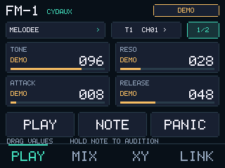
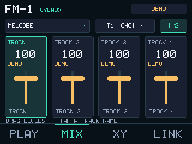
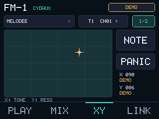
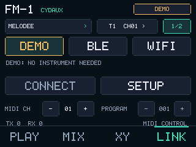
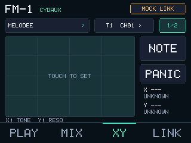
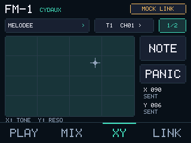

# Try the CYD before the FM-1 arrives

Run `python simulator/run.py` from the repository, or double-click
`Open-Simulator.cmd` in a Windows simulator package. The launcher opens
`http://127.0.0.1:8781/` in your browser. It needs Python 3.10 or later and uses
only Python's standard library.

A source checkout also needs `g++` or `clang++` with C++17 support for the first
build. A simulator package that includes `fm1-simulator.exe` beside `run.py`
does not need a compiler. The launcher also recognises binaries in `build/`.
Use `--binary PATH` for a different executable, `--port 8782` to change the
local port, or `--no-open` to leave browser opening to you.

The simulator runs the **same C++ controller, renderer and touch hit testing**
as the CYD firmware. The browser displays its real 320 × 240 framebuffer.
It does not run a second JavaScript interpretation of the controls.

## Windows prebuilt workflow

1. Download the `cydaux-simulator-windows-…` artifact from a successful **Build
   and qualify** run in the repository's Actions tab, then extract the complete ZIP.
2. Keep `run.py`, `index.html` and `Open-Simulator.cmd` together. The native
   `fm1-simulator.exe` may sit beside them or in the package's `build` folder.
   If the download contains only the executable, copy it into the `simulator`
   folder of the matching source checkout.
3. Install Python 3.10 or later if it is not already present, then double-click
   `Open-Simulator.cmd`. The browser opens the simulator automatically.
4. Leave the console window running while using the simulator. Press Ctrl+C
   in that window when finished. A compiler, MIDI interface and FM-1 are not
   needed for the prebuilt simulator.

The package includes its own [standalone quickstart](PACKAGE-README.md) with
paths relative to the extracted folder. Source-development commands later in
this guide apply to the complete repository checkout.

If a browser does not open automatically, open the local address printed in
the console. If another app already uses port 8781, run
`python run.py --port 8782` from the extracted simulator folder.

## Try these interactions

- Drag a value on Play, then switch to the second bank in the header.
- Tap the track selector to change the selected part. Mixer pages show four
  tracks at a time and follow that selection.
- Hold NOTE, or hold Space with the display focused. Release outside the
  display: the held note still ends.
- Drag the XY pad. The classic resistive CYD has a single-touch design.
- Tap the firmware name to cycle profiles, or use the dropdown outside the
  simulated device.
- Open Link and SETUP to inspect the configuration screen. The simulator's
  `CYDaux-DEMO` network is a visual example; it does not create an access point.

Local demo is available without an instrument. To inspect MIDI, choose Mock
Bluetooth or Mock Wi-Fi and Connect mock. All radio and instrument connections
in this browser simulator are simulated. It does not emulate the musical sound.

With mock returned values disabled, a control progresses from unknown to sent.
With returned values enabled, the mock generates a MIDI response and the shared
controller processes it. Mock replies keep the DEMO value origin, and the
prominent MOCK LINK label remains visible. DEVICE is reserved for values
received from a connection that is not marked as a mock.
The XY page follows the selected track's first two parameters even when the
second control bank is visible. It hides its cursor while either value is
unknown, and labels each axis as queued, sent, device or demo.

## Actual display examples

These are pixels from the shared C++ renderer, captured by
`render_examples.py`. They are not photographs of verified hardware.

| Play | Mixer |
| --- | --- |
|  |  |

| XY pad | Connection |
| --- | --- |
|  |  |

On a mock connection, unknown XY values do not imply a centered instrument
setting. A command changes the axis label to SENT. Mock MIDI replies are marked
DEMO, while a real connection's returned MIDI values are marked DEVICE.

| Unknown instrument values | Commands accepted by mock transport |
| --- | --- |
|  |  |

## Script the native simulator

The executable accepts one command per line and returns one JSON object per
command. `--script FILE` reads a sequence without a browser. Commands include:

```text
profile melodee
transport wifi
connect
echo off
down 60 80
move 120 80
up 120 80
page mix
frame mixer.ppm
state
quit
```

`tick N` advances the simulated clock by N milliseconds, up to 60,000 per call.
`rx 0xb0 0x4a 0x40` injects a complete mock MIDI message for protocol checks.
`cancel` releases captured input. `frame FILE.ppm` renders the shared UI as
an RGB PPM file. No simulator command flashes the CYD or the FM-1.

Run the UI and simulator checks using the repository's native qualification
commands. The Python launcher/frame/HTTP tests can be run independently with
`python -m unittest discover -s simulator -p 'test_*.py'` after the native
sources are available. `python simulator/render_examples.py` writes screenshots
from the native renderer into `docs/images/`.

With Node 18 or later installed, `node simulator/test_frontend.cjs` exercises
the actual frontend event handlers against the local HTTP server and native
controller. It covers final drag positions, keyboard notes, pointer cancellation
and stale responses. This uses a small DOM shim and does not replace a visual
check in a browser. An optional first argument selects a specific native binary.
